# Secure CI/CD Pipeline with Automated Rollback

A Jenkins CI/CD pipeline for a 2-service Spring Boot app (product-service and
order-service). Every commit is built, tested, analysed by SonarQube, scanned
by Trivy, packaged as a versioned Docker image, stored in Nexus and Docker Hub,
deployed with Docker Compose on AWS EC2, and rolled back automatically if the
new release fails its health check.

**Tech stack:** Jenkins, Maven, SonarQube, Trivy, Nexus, Docker, Docker Compose, Docker Hub, AWS EC2, Git

## Architecture

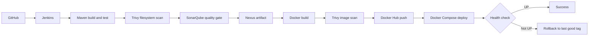

## Pipeline stages

| # | Stage | Tool | What it does |
|---|---|---|---|
| 1 | Checkout | Git | Pulls the code from GitHub |
| 2 | Build | Maven | Compiles and runs tests (`mvn clean verify`) |
| 3 | Filesystem scan | Trivy | Reports vulnerable dependencies |
| 4 | Code analysis | SonarQube | Quality gate fails the pipeline on bad code |
| 5 | Artifact | Nexus | Stores the built jars (`mvn deploy`) |
| 6 | Image build | Docker | One image per service, tag = build number |
| 7 | Image scan | Trivy | Reports image vulnerabilities |
| 8 | Push | Docker Hub | Publishes the versioned images |
| 9 | Deploy | Docker Compose | Starts the new containers on EC2 |
| 10 | Verify and rollback | Spring Boot Actuator | Polls `/actuator/health`, reverts on failure |

## Key features

- **Quality gate:** `sonar.qualitygate.wait=true` makes the Sonar stage fail when the gate fails, so Nexus, Docker and deploy never run for bad code.
- **Versioned images:** every image is tagged with the Jenkins build number, so each release is traceable and can be redeployed.
- **Non-root containers:** the Dockerfiles create and use a non-root user, with a memory limit set in Compose.
- **Secrets:** Docker Hub, GitHub and Nexus credentials live in Jenkins Credentials and managed files, never in the repo.
- **Automated rollback:** see below.

## Rollback logic

After `docker compose up -d`, the pipeline polls `/actuator/health` of both
services every 5 seconds for 2 minutes. When both report `UP`, the build tag is
saved as the last good tag. If they do not, the pipeline redeploys the saved
last good tag and marks the build as failed, so the application keeps running
on the previous working version.

## Rollback demo

I broke the health check on purpose to verify the rollback. The new release
failed its check, the pipeline redeployed the previous tag and failed the build.

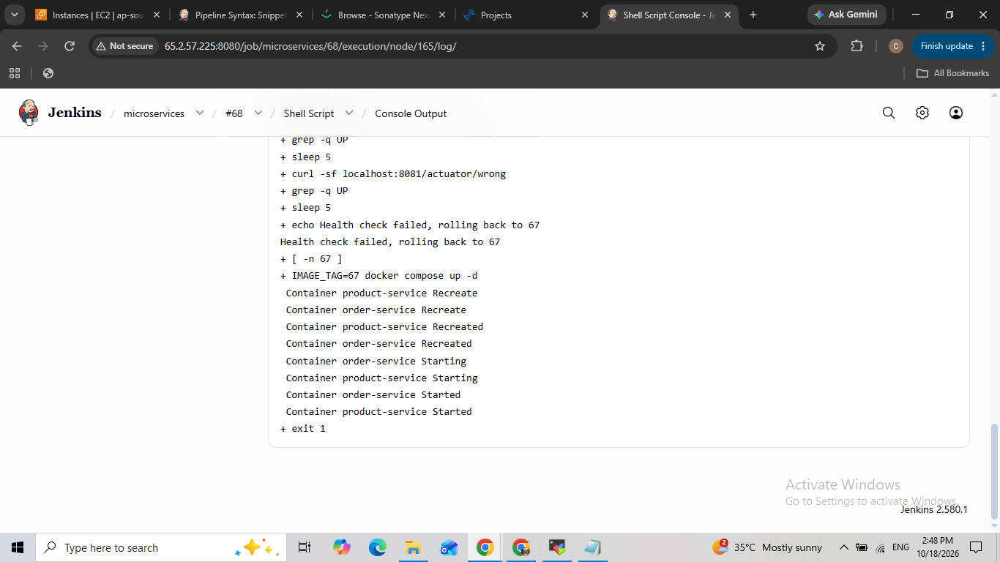
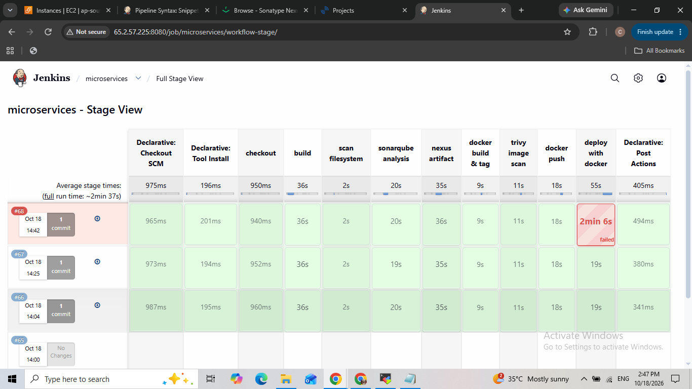

## Screenshots

**Pipeline run (all stages green)**

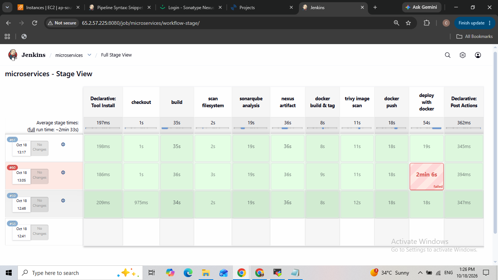
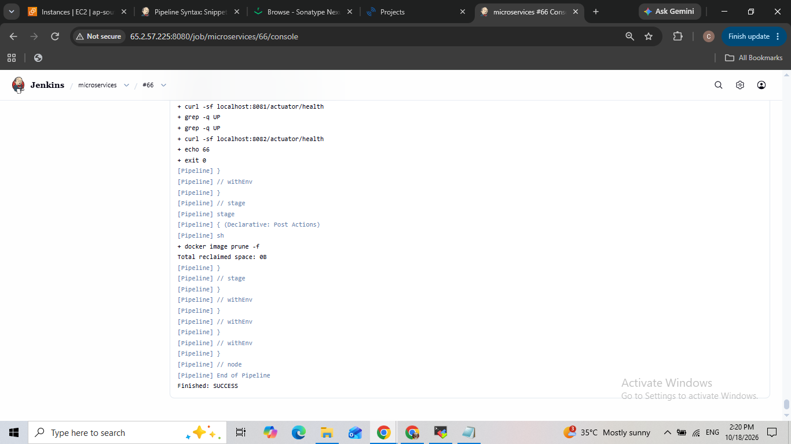

**SonarQube quality gate**

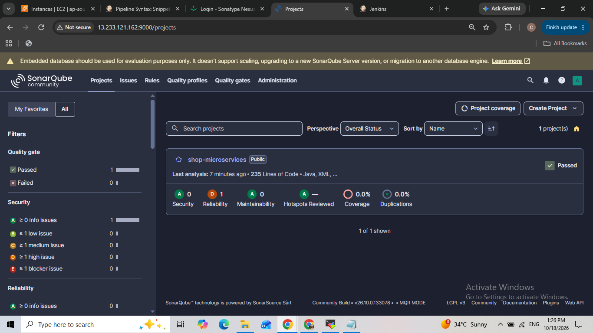

**Artifacts in Nexus**

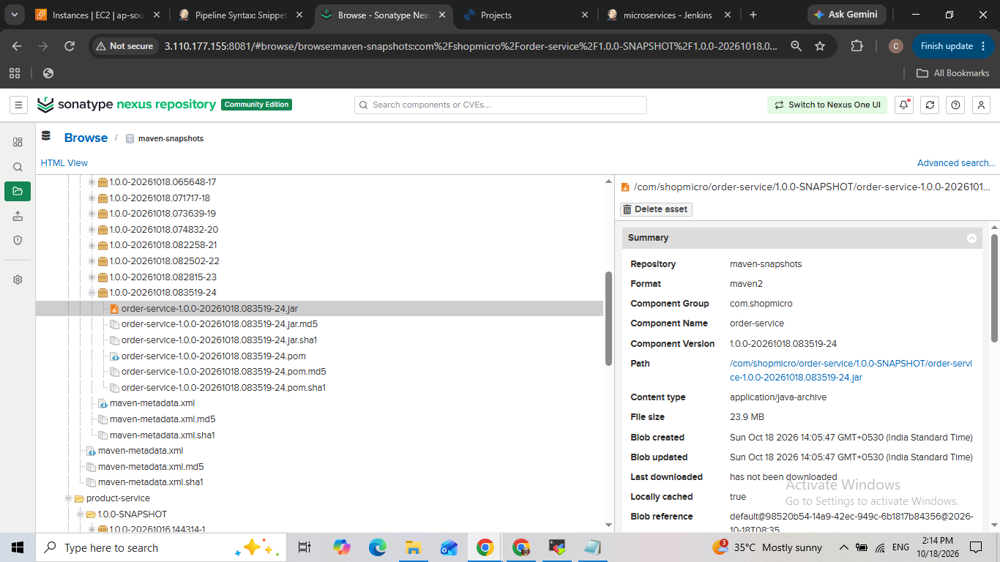
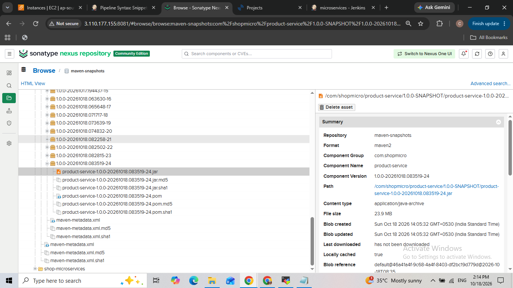

**Images in Docker Hub**

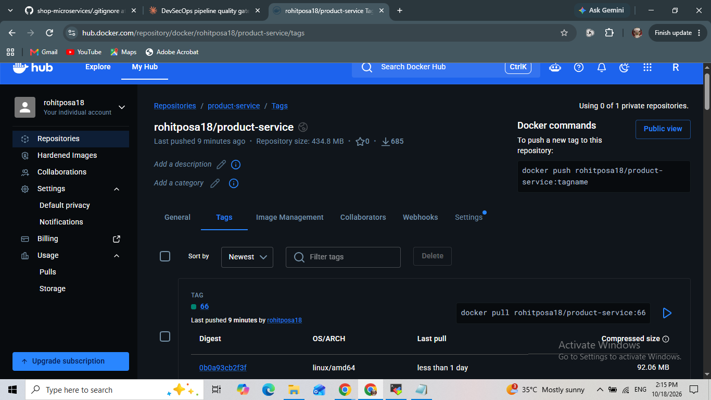
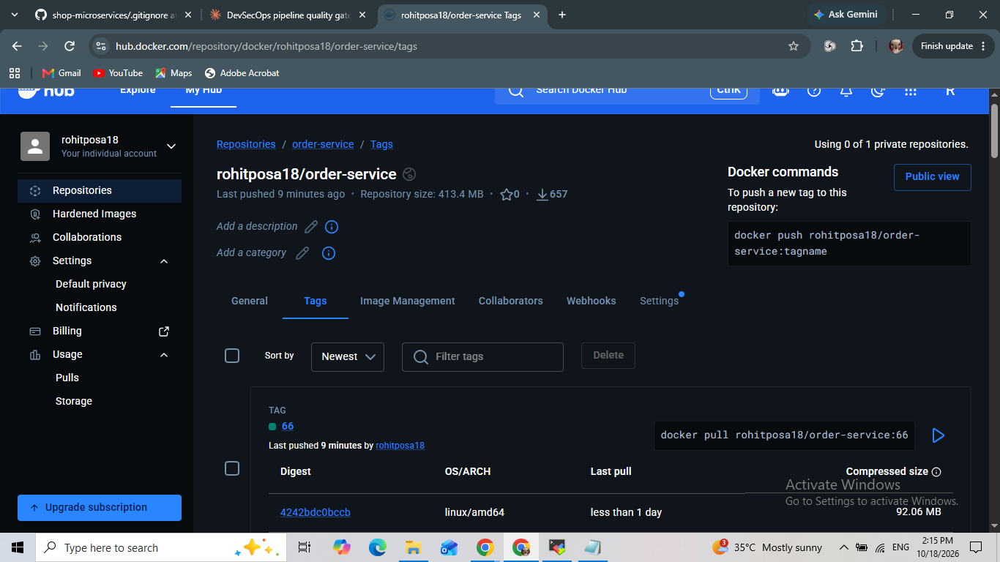

**Running containers and health**

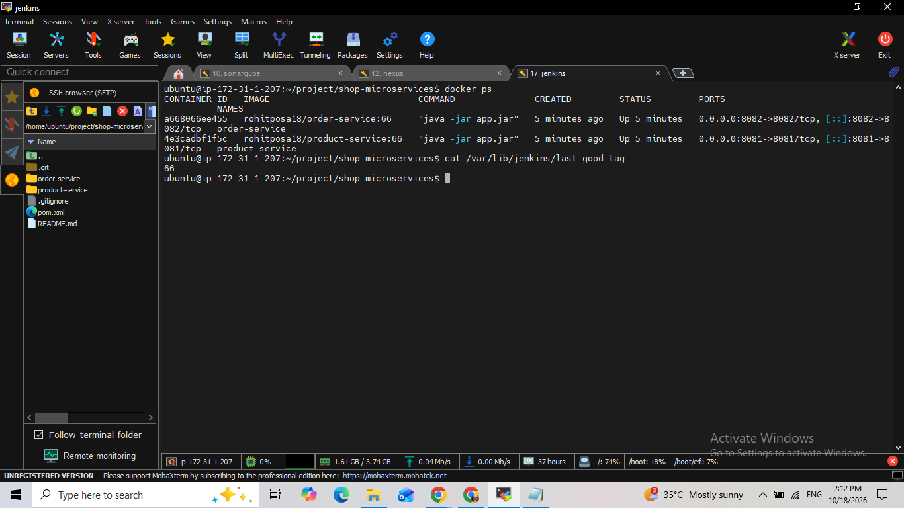
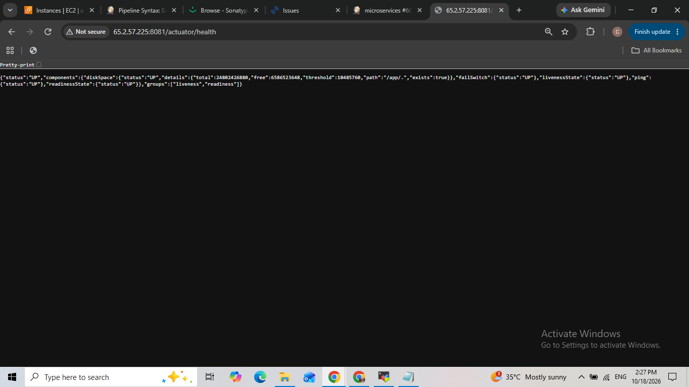

## Troubleshooting (real issues I faced)

| Problem | Root cause | Fix |
|---|---|---|
| Quality gate stage timed out | SonarQube webhook could not reach Jenkins (Security Group rule, then 403/404 on the webhook) | Opened the port for the SonarQube server and used `sonar.qualitygate.wait=true`, which removes the webhook dependency |
| Quality gate failed with 92% duplication | Sonar also scanned the generated Trivy report | Added `sonar.exclusions` for `target/` and the report files |
| `exit code 127`, `-Dsonar... not found` | A scanner flag was on a separate shell line, so the shell ran it as a command | Fixed the line continuation (`\`) |
| Nexus deploy: connect timed out, then 401 | Security Group did not allow Jenkins on port 8081, then the `settings.xml` server id did not match the pom | Opened the port and matched the server id and credentials |
| Sonar hotspot on Dockerfile | Container ran as root | Added a non-root user with `USER` |
| `docker build` argument error | Two commands ended up on one line | One command per line |
| Trivy: `no space left on device` | `/tmp` was a 1.9 GB tmpfs, too small for the Java vulnerability DB | Moved `/tmp` to the root disk |
| `unable to find Jenkinsfile` | File was named `jenkinsfile` while Jenkins looked for `Jenkinsfile` | Renamed the file |

## How to run

1. Jenkins with Maven, JDK 21, SonarQube Scanner, Docker and Trivy on the server.
2. SonarQube and Nexus running (separate EC2 instances).
3. Add Jenkins credentials: `git_credential`, `docker-credential`, a SonarQube server named `sonar`, and a Maven settings file `microservice` with the Nexus server id.
4. Create a Pipeline job: Pipeline script from SCM, this repo, script path `Jenkinsfile`.
5. Build Now. The apps run on ports 8081 and 8082.

## Result

Commit to running containers: **3 minutes** (from the Jenkins Stage View).

## Limitations and next steps

- Single server, so there are a few seconds of downtime when containers are recreated.
- Trivy reports vulnerabilities but does not fail the build; adding `--exit-code 1` would turn it into a gate.
- Kubernetes rolling updates (`rollout status` and `rollout undo`) would avoid the downtime and are the natural next step.
