# AI-Enhanced Secure CI/CD Pipeline with Automated Rollback

A Jenkins CI/CD pipeline for a 2-service Spring Boot app (product-service and
order-service). Every commit is built, tested, analysed by SonarQube, scanned
by Trivy, packaged as a versioned Docker image, stored in Nexus and Docker Hub,
deployed with Docker Compose on AWS EC2, and rolled back automatically if the
new release fails its health check.

Two AI steps built on the Gemini API summarize the Trivy scan reports into
prioritized fixes and analyze failed builds to suggest the likely root cause.
Both are advisory and non-blocking.

**Tech stack:** Jenkins, Maven, SonarQube, Trivy, Nexus, Docker, Docker Compose, Docker Hub, AWS EC2, Git, Python 3, Gemini API

## Architecture

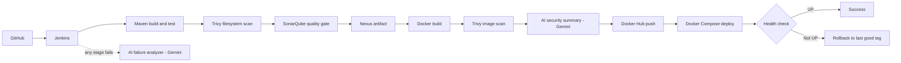

## Pipeline stages

| # | Stage | Tool | What it does |
|---|---|---|---|
| 1 | Checkout | Git | Pulls the code from GitHub |
| 2 | Build | Maven | Compiles and runs tests (`mvn clean verify`) |
| 3 | Filesystem scan | Trivy | Reports vulnerable dependencies |
| 4 | Code analysis | SonarQube | Quality gate fails the pipeline on bad code |
| 5 | Artifact | Nexus | Stores the built jars (`mvn deploy`) |
| 6 | Image build | Docker | One image per service, tag = build number |
| 7 | Image scan | Trivy | Reports image vulnerabilities |
| 8 | AI security summary | Gemini API | Turns the Trivy reports into a short, prioritized fix list (`ai-report-trivy.md`) |
| 9 | Push | Docker Hub | Publishes the versioned images |
| 10 | Deploy | Docker Compose | Starts the new containers on EC2 |
| 11 | Verify and rollback | Spring Boot Actuator | Polls `/actuator/health`, reverts on failure |
| Post | AI failure analyzer | Gemini API | On failure, analyzes the console log and writes `ai-report-log.md` |

## Key features

- **Quality gate:** `sonar.qualitygate.wait=true` makes the Sonar stage fail when the gate fails, so Nexus, Docker and deploy never run for bad code.
- **Versioned images:** every image is tagged with the Jenkins build number, so each release is traceable and can be redeployed.
- **Non-root containers:** the Dockerfiles create and use a non-root user, with a memory limit set in Compose.
- **Secrets:** Docker Hub, GitHub, Nexus and Gemini credentials live in Jenkins Credentials and managed files, never in the repo.
- **Automated rollback:** see below.
- **AI-assisted triage:** scan reports and failed builds are summarized by an LLM, see below.

## Rollback logic

After `docker compose up -d`, the pipeline polls `/actuator/health` of both
services every 5 seconds for 2 minutes. When both report `UP`, the build tag is
saved as the last good tag. If they do not, the pipeline redeploys the saved
last good tag and marks the build as failed, so the application keeps running
on the previous working version.

## Rollback demo

I broke the health check on purpose to verify the rollback. The new release
failed its check, the pipeline redeployed the previous tag and failed the build.

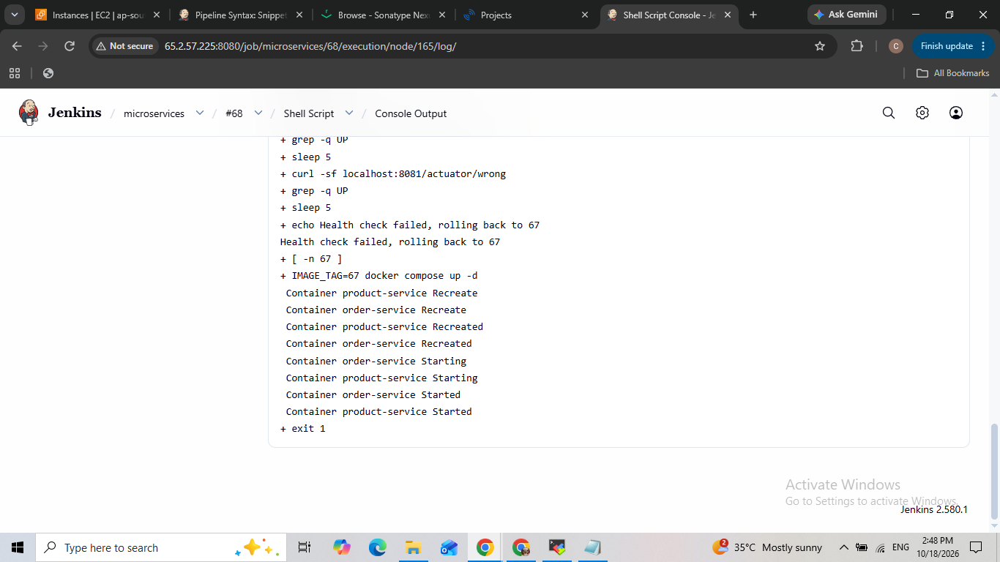
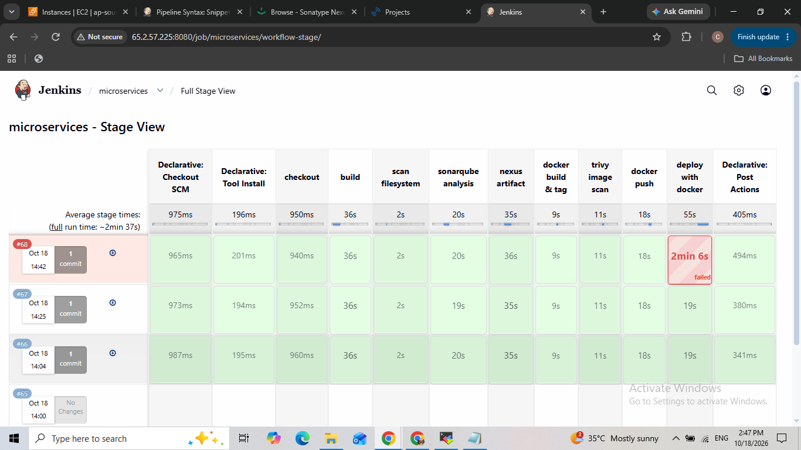

## AI add-ons (Gemini API)

Both features run through one script, `ai_analyze.py`, which uses only the
Python standard library.

| Feature | When it runs | Output |
|---|---|---|
| AI security summary | After the Trivy image scan, before the Docker Hub push | `ai-report-trivy.md`: up to 5 prioritized fixes (package, fixed version, what to change) |
| AI build failure analyzer | In `post { failure }` | `ai-report-log.md`: failing stage, likely root cause, top 3 fixes |

Both reports are archived as Jenkins build artifacts.

```
Trivy reports -> keep HIGH/CRITICAL lines (max 40) -> mask secrets -> Gemini API -> ai-report-trivy.md
Failed build log -> last 150 lines -> mask secrets -> Gemini API -> ai-report-log.md
```

**Design decisions**

- **Advisory and non-blocking:** the stage uses `|| true` and the script always exits 0, so an AI outage can never fail or block a release.
- **Reliability:** retries with exponential backoff and a fallback model. Gemini returned `503 UNAVAILABLE` (high demand) during testing, which is why this exists.
- **Cost and token control:** only HIGH/CRITICAL findings, the top 40 lines, the last 150 log lines and a 6000 character cap are sent.
- **Security:** the API key is a Jenkins secret text credential. Keys, tokens, passwords and bearer values are masked with regex before anything is sent, and only a dummy project is used.
- **Human review:** the output is a suggestion, not an action. One AI suggestion paired Spring Framework 7 with Spring Boot 3.x, which is incompatible, so every fix was checked against the Trivy "Fixed Version" column before it was applied.

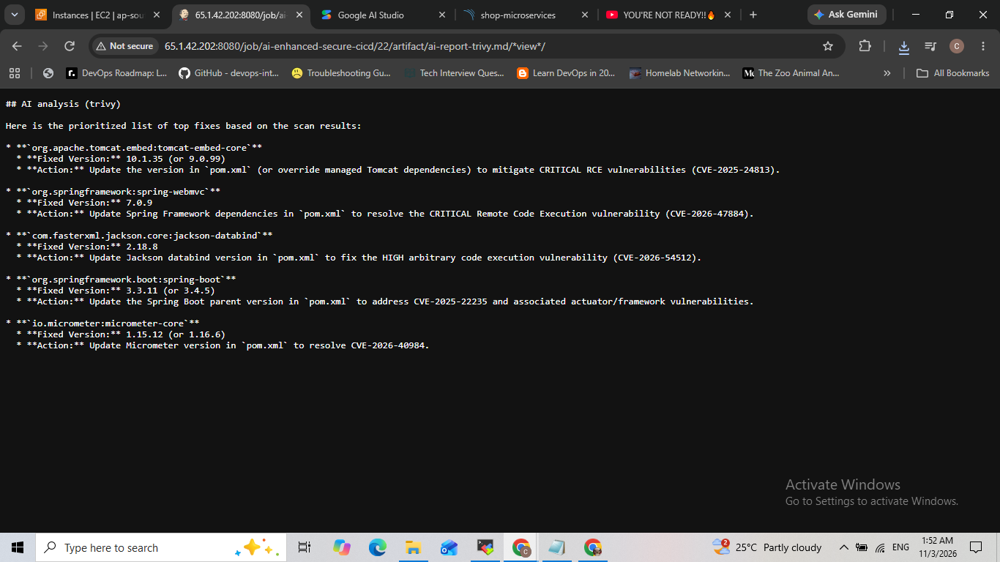
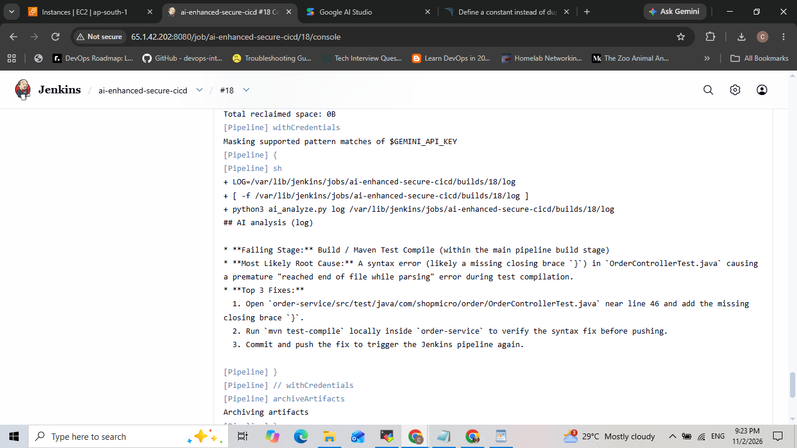


## Screenshots

**Pipeline run (all stages green)**

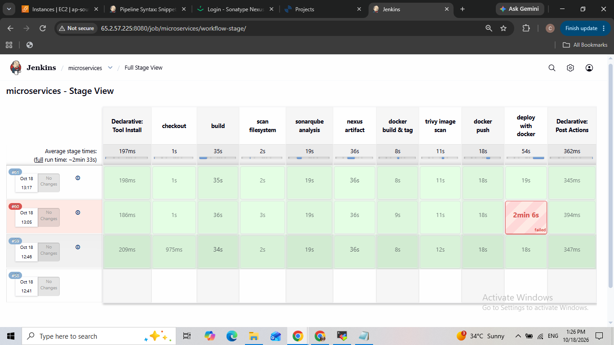
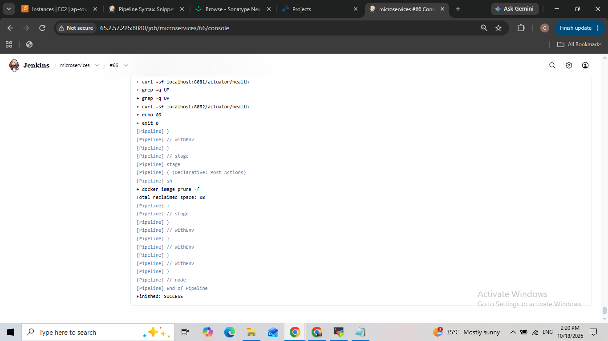

**SonarQube quality gate**

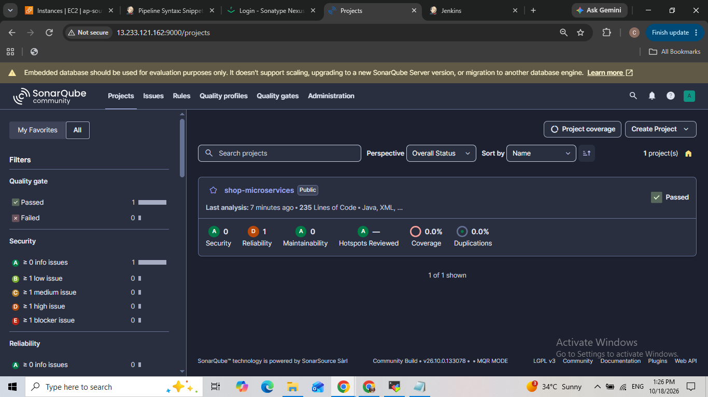

**Artifacts in Nexus**

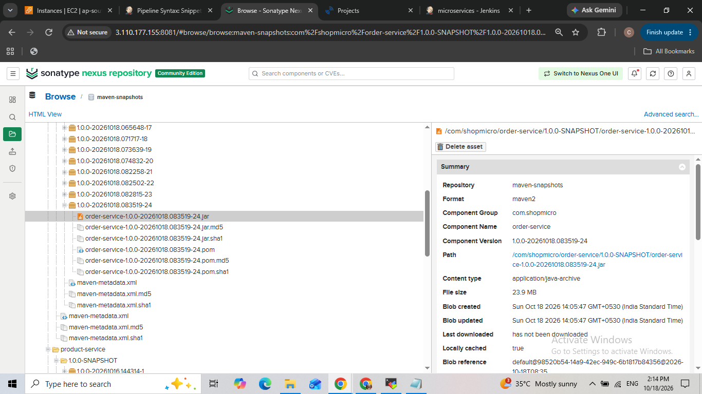
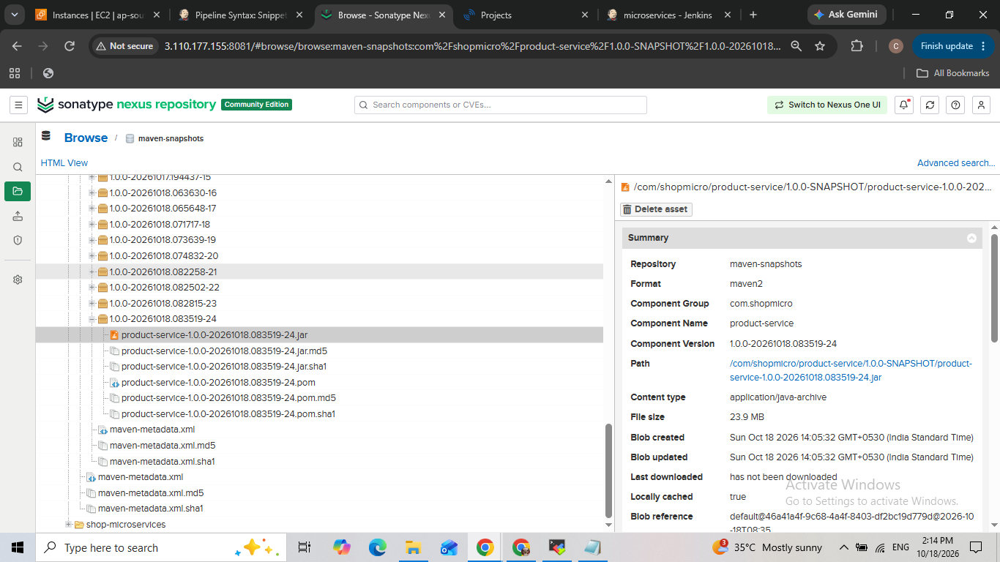

**Images in Docker Hub**

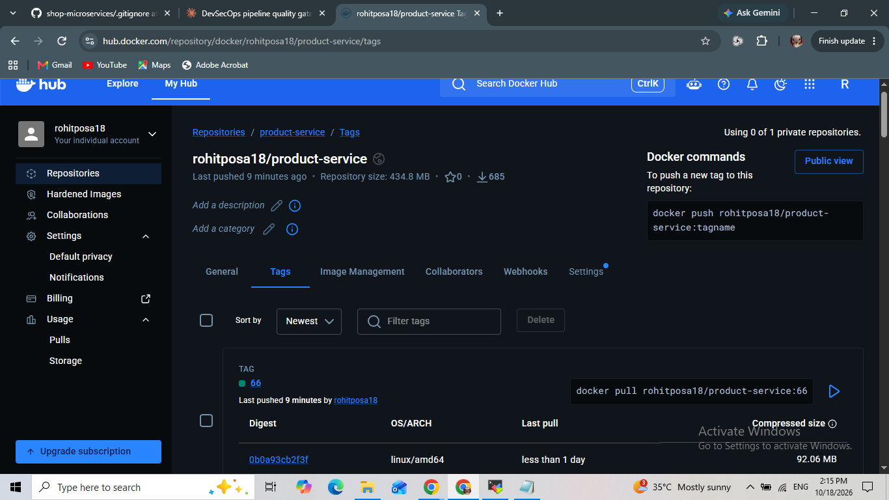
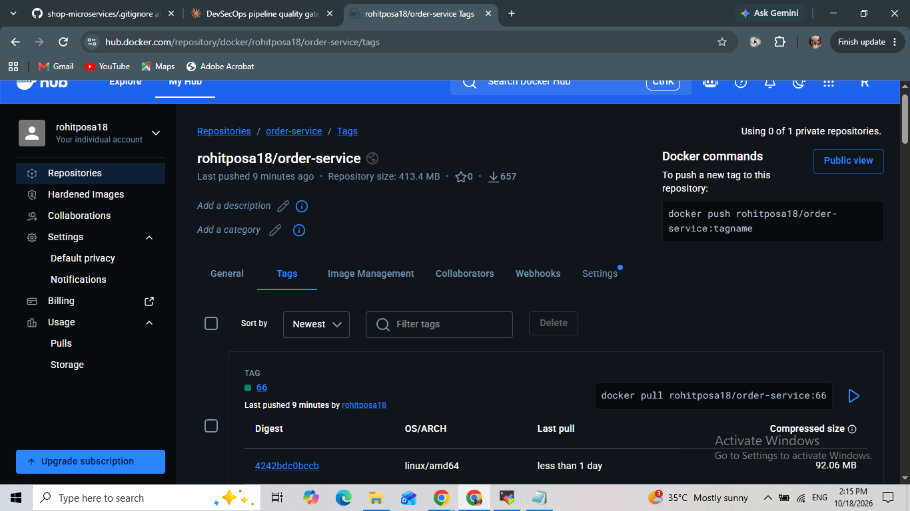

**Running containers and health**

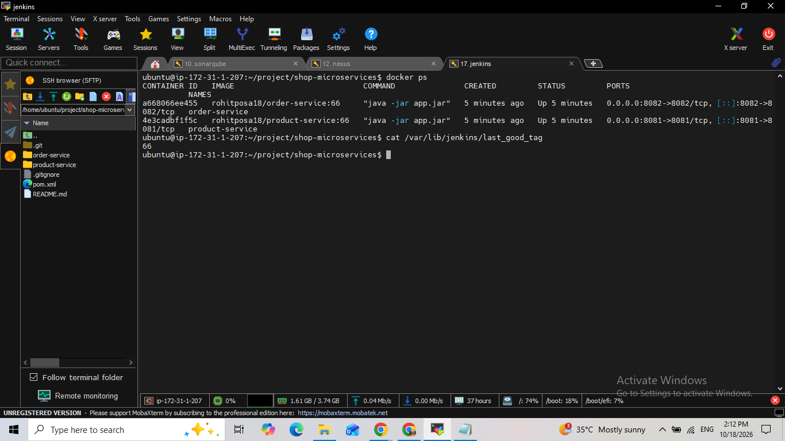
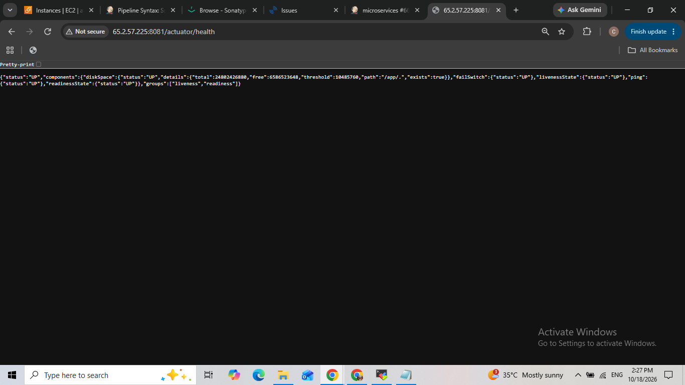

## Troubleshooting (real issues I faced)

| Problem | Root cause | Fix |
|---|---|---|
| Quality gate stage timed out | SonarQube webhook could not reach Jenkins (Security Group rule, then 403/404 on the webhook) | Opened the port for the SonarQube server and used `sonar.qualitygate.wait=true`, which removes the webhook dependency |
| Quality gate failed with 92% duplication | Sonar also scanned the generated Trivy report | Added `sonar.exclusions` for `target/` and the report files |
| `exit code 127`, `-Dsonar... not found` | A scanner flag was on a separate shell line, so the shell ran it as a command | Fixed the line continuation (`\`) |
| Nexus deploy: connect timed out, then 401 | Security Group did not allow Jenkins on port 8081, then the `settings.xml` server id did not match the pom | Opened the port and matched the server id and credentials |
| Sonar hotspot on Dockerfile | Container ran as root | Added a non-root user with `USER` |
| `docker build` argument error | Two commands ended up on one line | One command per line |
| Trivy: `no space left on device` | `/tmp` was a 1.9 GB tmpfs, too small for the Java vulnerability DB | Moved `/tmp` to the root disk |
| `unable to find Jenkinsfile` | File was named `jenkinsfile` while Jenkins looked for `Jenkinsfile` | Renamed the file |
| Gemini API `503 UNAVAILABLE` | The model was under high demand on Google's side | Added retries with exponential backoff and a fallback model; the AI step is non-blocking |
| `Non-resolvable parent POM ... spring-boot-starter-parent:4.2.0` | That version does not exist on Maven Central | Checked the available releases, then used 3.5.16 |
| Trivy results identical before and after the "fix" | `pom.xml` had not actually been changed yet | Confirmed with `git status` and `git diff`, changed the parent version and re-scanned |
| AI suggested Spring Framework 7 with Spring Boot 3.x | The LLM proposed per-library fixes without checking compatibility | Cross-checked with the Trivy report and upgraded the Spring Boot BOM instead |
| `cp: cannot stat` when copying reports | The Jenkins job name contained spaces, so the shell split the path | Quoted the path and renamed the job without spaces |

## How to run

1. Jenkins with Maven, JDK 21, SonarQube Scanner, Docker, Trivy and Python 3 on the server.
2. SonarQube and Nexus running (separate EC2 instances).
3. Add Jenkins credentials: `git_credential`, `docker-credential`, `gemini-api-key` (secret text), a SonarQube server named `sonar`, and a Maven settings file with the Nexus server id.
4. Set `GEMINI_MODEL` (and optionally `GEMINI_FALLBACK_MODEL`) in the `environment` block of the `Jenkinsfile`.
5. Create a Pipeline job: Pipeline script from SCM, this repo, script path `Jenkinsfile`.
6. Build Now. The apps run on ports 8081 and 8082. Open the build's Artifacts to read `ai-report-trivy.md`.

## Result

Commit to running containers: **about 3 minutes** (from the Jenkins Stage View).

## Limitations and next steps

- Single server, so there are a few seconds of downtime when containers are recreated.
- Trivy reports vulnerabilities but does not fail the build; adding `--exit-code 1` would turn it into a gate.
- Spring Boot 3.5 is no longer in open-source support (since June 2026), so the next upgrade is to a supported 4.x release, which is a major migration and needs a separate branch and test run.
- The AI output is advisory and can be wrong, so fixes still need human review. Parsing Trivy as JSON instead of table text would make the input more reliable.
- Possible additions: Slack or email notifications, and an AI summary of the SonarQube issues.
- Kubernetes rolling updates (`rollout status` and `rollout undo`) would avoid the downtime and are the natural next step.
